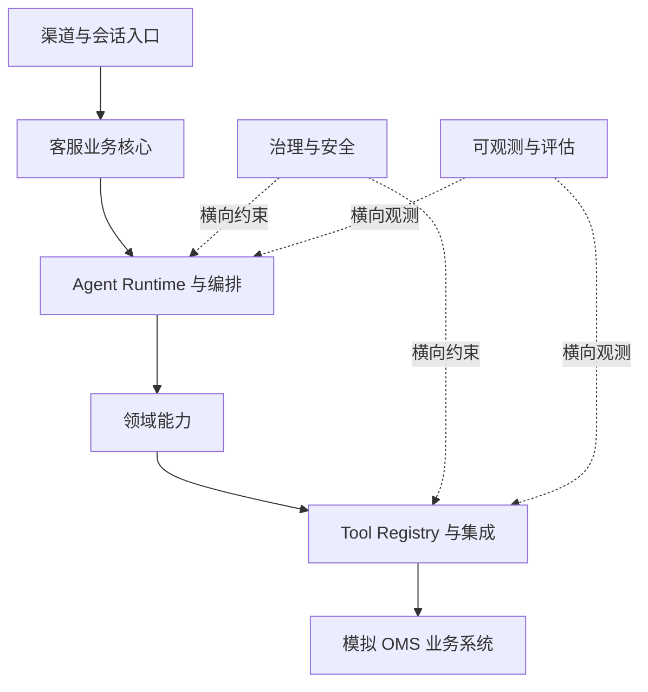

# 总体架构基线

## 1. 架构目标

系统以电商客服为场景，构建一个可执行、可观测、可恢复和可评估的企业级 Agent 工程系统。架构必须同时满足：

- 多轮对话能够理解用户目标。
- 业务数据通过受控 Tool 获取。
- 高风险操作通过确定性 Workflow 执行。
- 权限、规则和审计在模型之外强制执行。
- 失败能够定位、恢复并转交人工。
- 模型、Prompt 和 Tool 的变化能够回归评估。

## 2. 核心决策

M1 采用：

> 单主 Agent + 多个领域 Tool + 显式业务 Workflow。

不为商品、订单、物流和售后分别创建独立 Agent。领域能力优先实现为 Tool；只有独立推理、独立上下文和复杂规划确有需要时才拆分子 Agent。

相关决策见 `docs/adr/0001-agent-tool-workflow.md`。

## 3. 逻辑分层



### L1 渠道与会话入口

M1 只有 Web Chat。以后增加微信、App 和人工坐席时，通过 Channel Adapter 转换为统一消息格式。

### L2 客服业务核心

负责会话、用户身份、订单访问上下文、人工接管和工单。业务事实以数据库为准，不以对话历史为准。

### L3 Agent Runtime 与编排

负责意图理解、上下文构建、模型调用、Tool 选择和状态持久化。Runtime 不能自行解释业务资格。

### L4 领域能力

M1 仅包括订单查询和订单取消。商品问答、导购、物流和退款在后续里程碑增加。

### L5 Tool 与集成

负责 Tool 注册、JSON Schema 校验、授权、超时、重试、结果归一化和 API 适配。

### L6 治理与安全

横向覆盖身份、租户隔离、权限、策略、人工审批、审计和敏感信息保护。

### L7 可观测与评估

横向记录用户消息、意图、规划、Tool 调用、API 请求/响应、状态转换和最终结果，并运行离线评测。

## 4. M1 请求流程

```text
Web Chat
  -> Conversation API
  -> Agent Runtime
       -> Intent Router
       -> Context Builder
       -> Tool Planner
  -> Authorized Tool Gateway
       -> list_orders / get_order
       -> get_cancel_eligibility
  -> Cancellation Workflow
       -> user confirmation
       -> submit_cancel(idempotency_key)
       -> get_cancel_result
  -> Result Validator
  -> Final Response
```

## 5. 模型与确定性代码的边界

### 模型负责

- 识别用户意图和缺失参数。
- 决定是否需要澄清。
- 从允许的 Tool 中选择合适的查询能力。
- 将结构化业务结果转化为清晰、准确的用户表达。

### 确定性代码负责

- 用户身份和租户解析。
- 订单归属与数据权限。
- 取消资格和业务规则。
- 参数 Schema 校验。
- 用户确认状态。
- 幂等键生成与去重。
- Workflow 状态转换、重试、恢复和结果校验。
- 人工审批与审计。

## 6. 数据职责

| 数据 | 权威来源 | 说明 |
|---|---|---|
| 对话记录 | PostgreSQL | 用于恢复体验，不替代业务事实 |
| 当前任务状态 | Workflow 持久化表 | 包含步骤、确认和错误信息 |
| 订单与取消结果 | 模拟 OMS | Tool 查询，不做本地擅自推断 |
| Tool 执行记录 | 审计/Trace 存储 | 包含请求标识、耗时和结果分类 |
| 用户画像 | 后续客户中心 | M1 不建设 |
| 知识库 | 后续 RAG | M1 不建设 |

Redis 可用于短期会话缓存，但不得成为取消任务或业务状态的唯一持久化来源。

## 7. 建议技术基线

以下为 M1 拟定方案，需通过 ADR 确认后执行：

- 后端：Python + FastAPI。
- 前端：Next.js Web Chat。
- 数据库：PostgreSQL。
- 后端依赖管理：优先使用 `uv`。
- 可观测性：OpenTelemetry + 结构化日志。
- Agent 运行时：应用自有的窄 Runtime，不将业务状态托付给单一 Agent 框架。
- Workflow：数据库持久化的显式状态机，M1 不引入重量级工作流平台。
- 业务系统：本地可控的 Mock OMS。

## 8. 模块边界

建议目录只作为后续脚手架方向：

```text
apps/web/                     # Web Chat
services/api/                 # API、会话和身份入口
services/agent_runtime/       # 意图、上下文、模型和 Tool 规划
services/tools/               # Tool Registry 与授权网关
services/workflows/           # 取消等显式流程
services/mock_oms/            # 模拟订单业务系统
packages/contracts/           # OpenAPI、JSON Schema 和生成类型
evals/                        # 场景集、运行器和报告
```

模块约束：

- `agent_runtime` 不得直接导入 `mock_oms`。
- `workflows` 只能通过受控 Tool/Adapter 访问业务系统。
- `apps/web` 不得承载订单业务规则。
- `packages/contracts` 是跨模块接口的唯一定义来源。

## 9. 演进原则

- M1 先验证交易闭环，再扩展知识和售前能力。
- 多租户、授权、幂等和审计从 M1 开始存在，后续只做增强。
- 评测集从 M1 建立，不能等到系统“做完”再补。
- 多 Agent、渠道扩展和复杂运营能力必须由实际需求驱动，不能为架构展示提前引入。

## 10. 术语

- **OMS（Order Management System，订单管理系统）**：真实电商中保存订单并驱动其状态流转的业务系统，下单、支付、备货、发货、签收和取消都以它为准。本项目里它是“最终说了算”的外部系统。
- **Mock OMS**：按真实 OMS 行为自行实现的模拟服务，数据可控并可注入故障（超时、重复响应、格式错误、已成功但回包丢失），用于开发和测试；M1 不接入真实 OMS。
- **Tool**：Agent 可调用的领域能力接口，带输入 Schema 和授权检查，如 `get_order`。Tool 只查询或执行受限动作，不承载业务规则。
- **Tool Gateway**：所有 Tool 调用的统一入口，负责鉴权、Schema 校验、身份注入、超时、重试、结果归一化和审计。
- **Workflow**：用确定性代码实现、状态持久化的业务流程。高风险写操作只能由 Workflow 在满足前置条件后执行。
- **Agent Runtime**：负责意图理解、上下文构建和 Tool 规划的部分，不解释业务规则，也不直接执行写操作。
- **幂等键（idempotency key）**：一次业务操作的稳定标识；用同一个键重复提交，业务上只产生一条结果。
- **用户（user）**：一个人，代表登录身份。M1 中一个用户属于且仅属于一个租户。
- **租户（tenant）**：一层数据隔离边界，通常对应一家公司或一个店铺。一个租户包含多个用户；不同租户的数据默认完全不可见。

  两者的检查顺序是“先租户、后用户”：会话解析出 `(tenant_id, user_id)` 后，网关用这一对值判断订单是否可见。订单属于同租户的另一个用户时返回“查无此单”（AC-02）；号段跨租户时由服务端拒绝，且请求体不能覆盖租户（AC-03）。

