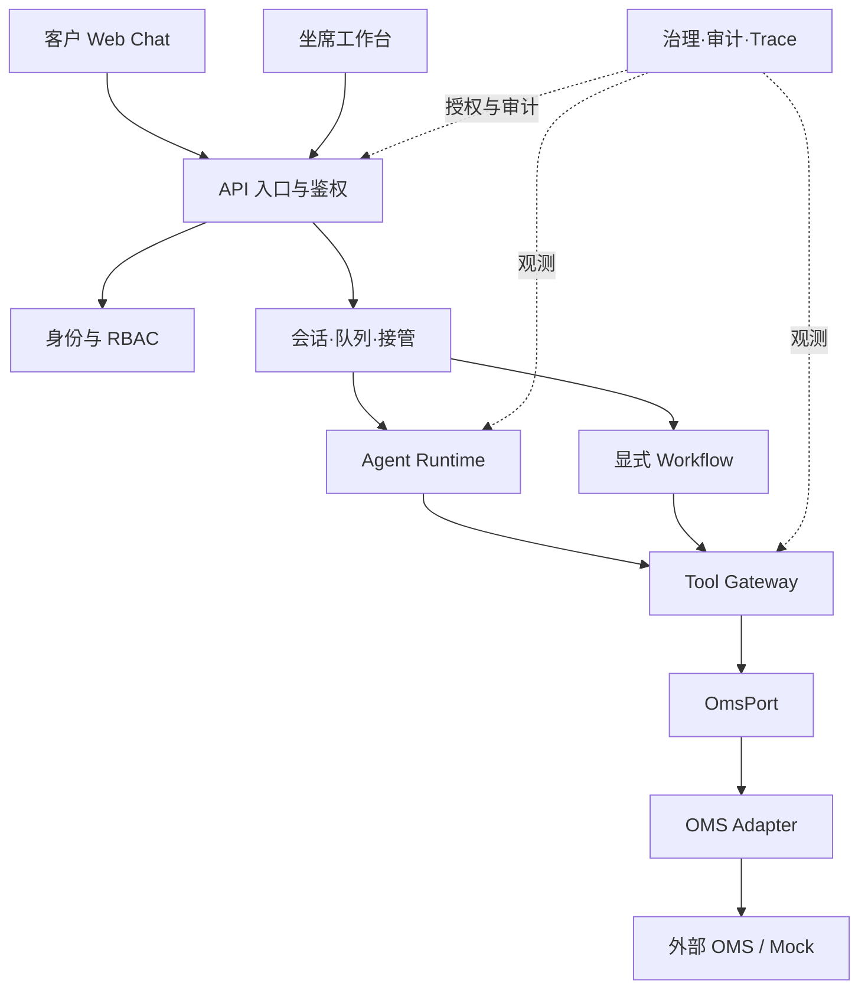

# 总体架构基线

- 状态：已批准
- 日期：2026-11-16
- 批准：2026-11-16（随 ADR-0005 与 R0-1 基线批准）
- 依据：[产品宪章](../product/charter.md)、[ADR-0005 企业客服边界](../adr/0005-enterprise-boundary.md)
- 归档：2026-11-14 的消费者 M1 架构对应 M1-P 原型，不再作为新开发依据
- 后续变更：2026-11-16 [ADR-0006](../adr/0006-customer-login.md) 将客户改为登录客户；本文的匿名会话/订单尾号内容由 M1 设计替换

## 1. 架构目标

系统以电商客服为场景，构建企业内部 AI 客服系统。架构必须同时满足：

- 客户匿名聊天，AI 默认自动回复并完成订单类任务。
- 客户可随时转人工；转人工必须有队列、坐席和接管，不是死路。
- 员工身份、会话、队列、接管、回复与审计都是真实业务代码。
- 权限、规则与审计在模型之外强制执行。
- 失败能够定位、恢复并转交人工。
- 模型、Prompt 和 Tool 的变化能够回归评估。
- 只有 OMS 等外部业务系统允许 Mock。

## 2. 核心决策

沿用 ADR-0001 的执行模型，并补上人机协同边界：

> 单主 Agent + 领域 Tool + 显式 Workflow + 真实坐席闭环。

客户聊天与坐席工作台是两个前端、两个入口；后端是一个模块化单体。领域能力优先实现为 Tool，只有独立推理与上下文确有需要时才拆子 Agent。

## 3. 逻辑分层



### L1 入口层

- **客户 Web Chat**：客户登录入口，不承载业务规则。
- **坐席工作台**：员工入口，展示队列、会话、订单与 AI 轨迹。
- 两个前端只通过 HTTP 与 `packages/contracts` 访问后端。

### L2 业务核心

负责客户会话与消息、员工身份/RBAC/session、交接单、队列、领取、接管、回复、关闭和转回 AI。业务事实以数据库为准，不以对话历史为准。

### L3 Agent Runtime 与编排

负责意图理解、上下文构建、模型调用、Tool 选择和回复生成。Runtime 不解释业务资格，也不直接执行写操作。

### L4 领域能力

M1 包括订单查询与未发货订单取消；退款在 M2，知识在 M3。领域能力通过 Tool 暴露，业务规则在确定性代码中。

### L5 Tool 与集成

负责 Tool 注册、JSON Schema 校验、授权、超时、重试、结果归一化和审计。外部业务系统统一经 Port + Adapter 接入。

### L6 治理与安全

横向覆盖客户/员工认证、RBAC、会话归属、订单访问、策略、审计、限速与敏感信息保护。

### L7 可观测与评估

横向记录客户消息、意图、Tool 调用、状态转换、转人工、接管、回复与最终结果，并运行离线评测。

## 4. M1 请求流程

### 4.1 客户消息与 AI 回复

```text
Web Chat
  -> Conversation API（匿名 session、限速、消息持久化）
  -> Agent Runtime
       -> 意图与上下文
       -> Tool Gateway
            -> OmsPort：查单 / 取消资格
       -> Cancellation Workflow：确认 / 幂等提交 / 结果查询
  -> 转人工判定（客户要求 / 低置信 / 高风险 / 规则要求）
       -> 创建交接单并入队
  -> 回复客户（AI 回复或“已转人工”）
```

### 4.2 坐席接管与关闭

```text
坐席登录
  -> 服务端 session + RBAC（agent）
  -> 队列：查看可领取会话
  -> 领取（版本校验，防重复领取）
  -> 接管（会话归属 + 状态转换 + 审计 + 系统消息“人工已接入”）
  -> 查看消息、订单、AI Trace、交接单
  -> 回复；符合条件的取消经确认后由 Workflow 提交
  -> 关闭会话或转回 AI
```

### 4.3 订单访问

```text
客户登录（预置账号 + 密码）
  -> 服务端 session
  -> OmsPort 按 customer.user_id 校验租户与订单归属
  -> 仅返回本人账号名下订单
  -> 他人/跨租户统一“查无此单”
```

ADR-0006 已删除订单号 + 手机尾号校验；完整手机号不落库/日志。

## 5. 事务与 seam 归属

| 组件 | 提交什么 | 不负责 |
|---|---|---|
| 写请求 UoW（`get_session`，`scope="function"`） | 请求内全部业务写：成功 `commit`、异常 `rollback`；commit 失败在响应发送前返回 500 | 独立事务 |
| 只读请求会话（`get_read_session`，`scope="function"`） | 不提交；认证依赖与 GET 路由复用同一只读 session | 业务写、独立事务 |
| 路由与业务模块 | 只 `flush`，不 `commit` | 提交时机 |
| 客户 `last_seen_at` | 认证后按会话 5 分钟节流，独立短事务 | 请求事务 |
| 限速（`identity/rate_limit.py`） | 独立 session 提交桶计数 | 业务事务 |
| 安全事件审计 | 独立 session 提交 401/403/429 | 业务事务 |
| `AsyncTraceSink` | 独立 session 写工具执行记录 | 业务事务/请求 session |
| Tool Gateway | `tool_executions`（写前 `started`、完成/拒绝） | 业务事务 |
| Cancellation Workflow | 任务状态 + 转换/确认审计；启动恢复用独立 session | 工具执行记录、HTTP 响应 |
| 启动恢复 | 逐任务复用 `trace_id` 执行，不新建 `startup-*` | 建立新 trace |

排查提交顺序时先看这张表。写请求成功时由 `get_session` 统一提交，GET 用 `get_read_session` 不提交；路由与业务模块不得再调用 `commit()`。需要独立事务的写入必须用 `session_factory()` 新开 session，并在组件名或注释中标注（[ADR-0009](../adr/0009-request-unit-of-work.md)）。
Trace/审计的分级与失败语义见 [ADR-0012](../adr/0012-observability-grading.md)；步骤 1（错误拆分与失败语义）已实现；采样、异步缓冲与读访问审计待排期。

连接资源：业务池由 `DB_POOL_*` 配置，Trace 用独立小池（`TRACE_POOL_*`）。每 worker 上限 = 业务 `size+overflow` + Trace `size+overflow`（默认 19）；部署按 `workers × 上限 ≤ PostgreSQL max_connections` 核算（[ADR-0010](../adr/0010-connection-pool-and-trace-pool.md)）。读请求只占一个只读连接；写请求在认证阶段额外占一个只读连接，按写请求并发估算时需要预留。

## 6. 模型与确定性代码的边界

### 模型负责

- 识别客户意图、缺失参数与是否需要澄清。
- 从允许的 Tool 中选择查询能力。
- 生成交接单摘要草稿与客户可读回复。
- 在规则允许时解释业务结果。

### 确定性代码负责

- 客户匿名 session 的签发、校验与限速。
- 员工身份、密码校验、session 与 RBAC。
- 订单访问校验和会话归属。
- 订单资格、取消规则、用户确认与幂等。
- 队列、领取、接管、关闭的状态转换。
- 转人工触发：客户明确要求、低置信阈值、高风险规则、Workflow 未知状态。
- 参数 Schema 校验、Workflow 重试/恢复/结果校验。
- 审计与敏感信息脱敏。

模型可以建议转人工，但是否转人工、转给哪个队列由确定性策略决定。

## 7. 数据职责

| 数据 | 权威来源 | 说明 |
|---|---|---|
| 客户会话与消息 | PostgreSQL | 支持同一浏览器会话恢复，不替代业务事实 |
| 匿名客户 session | PostgreSQL + 签名 token | 不保存客户账号；token 不含敏感信息 |
| 员工账号与密码哈希 | PostgreSQL | 密码算法在 M1 规格确定 |
| 员工 session | PostgreSQL | 服务端 session，可撤销 |
| 交接单、队列、领取与接管 | PostgreSQL | 主路径状态，不得只存内存或 Redis |
| 当前任务状态 | Workflow 持久化表 | 含步骤、确认和错误信息 |
| 订单与取消结果 | OMS（Mock/Http） | 经 OmsPort 查询，不擅自推断 |
| Tool 执行记录与审计 | 审计/Trace 存储 | 含请求标识、耗时和结果分类 |
| 客户画像 | 后续客户中心 | M1 不建设 |
| 知识库 | 后续 RAG | M3 建设 |

Redis 可用于短期缓存或限速，但不得成为会话归属、队列或取消状态的唯一持久化来源。队列先落 PostgreSQL，不引入消息中间件。

## 8. 技术基线

沿用 ADR-0004，不重复锁定版本：

- 后端：Python 3.12 + FastAPI。
- 前端：Next.js（App Router）+ TypeScript strict，包管理用 `pnpm`。
- 数据库：PostgreSQL 17。
- 后端依赖管理：`uv`。
- 契约：OpenAPI 为唯一来源；JSON Schema 只用于 Tool 输入。
- 可观测：结构化日志 + `trace_id` + OpenTelemetry。
- Agent 运行时：应用自有的窄 Runtime，不把业务状态托付给单一 Agent 框架。
- Workflow：数据库持久化的显式状态机，不引入重量级工作流平台。
- 业务系统：通过 OmsPort 接入；开发与测试用 Mock Adapter。

## 9. 模块边界与依赖规则

目标目录（R0-2 先立骨架，M1 规格再补全）：

```text
apps/
  chat/                     # 客户 Web Chat（预置账号登录）
  workspace/                # 坐席工作台
backend/
  api/                      # 应用装配、中间件、共享 HTTP 错误与审计编排
    main.py
    csrf.py
    request_id.py
    errors.py
    service_audit.py
    audit.py                # 旧取消工作流审计（保留）
    admin_routes.py         # 仅开发/测试的 Mock OMS 故障注入
  platform/                 # 配置、数据库、trace、共享 HTTP 工具与错误封套
  identity/                 # 客户/员工认证、session、RBAC；http.py 为员工入口
  conversations/            # 会话、消息、交接单、队列、领取/接管；*_http.py 为域入口
  audit/                    # 审计写入
  agent_runtime/            # 意图、上下文、模型调用、Tool 规划
  tools/                    # Tool Registry 与授权网关
  workflows/                # 取消等显式流程
  adapters/
    oms/                    # OmsPort + Mock/Http Adapter + factory
packages/contracts/         # OpenAPI、JSON Schema 与生成类型
evals/                      # 场景集、运行器和报告
```

模块约束：

- `backend/` 是模块化单体的后端源码根，不是独立微服务；模块边界由本节规则与 `check-imports.py` 强制。
- `apps/*` 只通过 HTTP 与契约访问后端，不承载业务规则。
- `agent_runtime`/`tools`/`workflows` 不得 import `backend.api`。
- `tools`/`workflows` 不得 import `mock_oms` 或任何具体 OMS Adapter。
- 只有 `adapters/oms/factory` 读取 OMS 配置并选择 Adapter；生产缺配置启动失败。
- `packages/contracts` 是跨模块接口的唯一定义来源。
- 业务 HTTP 入口按域放在 `identity/http.py`、`conversations/*_http.py`；`api/` 只做装配与横切，不新增业务路由（[ADR-0008](../adr/0008-business-domain-http-layout.md)）。
- `apps/web` 已于 2026-11-18 退役；M1-P 的旧 Web 接口（`/session`、`/message`、`/handoff`、`/cancellation-requests`）已于 2026-11-19 退役，`agent_runtime`/`tools`/`workflows` 与旧表保留供 003/004 接入；其中无生产入口的 `agent_runtime/chat.py` 旧对话编排已于 2026-11-19 删除（保留 `model`/`types` 供现役链路）。`mock_oms` 已在 R0-2 迁入 `backend/adapters/oms/`。

## 10. 演进原则

- 先立模块与依赖边界，再在边界内加功能。
- 客户闭环与坐席闭环必须同时可走，不把工作台当后续优化。
- 权限、幂等、审计和 Trace 从 M1 开始存在，后续只增强。
- 评测集从 M1 建立，不能等系统“做完”再补。
- 真实 OMS 在契约稳定后接入；Mock 只用于开发和测试。
- 多 Agent、多渠道和运营能力必须由实际需求驱动，不能为架构展示提前引入。

## 11. 术语

- **客户（customer）**：企业外部消费者。M1 使用预置账号 + 密码登录，不是匿名用户。
- **客户 session**：客户登录后由服务端签发的会话标识；绑定客户账号、消息与订单归属。
- **订单归属（order ownership）**：订单属于客户账号；客户只能访问本人同租户订单，坐席按交接单 `verified_order_ids` 访问。
- **坐席（agent）**：企业内部客服人员，M1 唯一员工角色，使用本地账号登录工作台。
- **工作台（workspace）**：坐席前端，展示队列、会话、消息、订单、AI 轨迹与交接单。
- **交接单（handoff）**：转人工时生成的上下文包，含对话摘要、订单、AI 轨迹与待办；进入队列等待坐席领取。
- **队列（queue）**：待领取交接单的集合，状态落 PostgreSQL。
- **接管（takeover）**：坐席取得会话控制权并通知客户“人工已接入”的状态转换。
- **OMS（Order Management System，订单管理系统）**：真实电商中保存订单并驱动其状态流转的业务系统，下单、支付、备货、发货、签收和取消都以它为准。
- **Mock OMS**：按真实 OMS 契约实现的模拟适配器，数据可控并可注入故障（超时、重复响应、格式错误、已成功但回包丢失），只用于开发和测试。
- **OmsPort**：业务模块依赖的订单接口抽象；具体 Adapter 由 factory 选择。
- **Tool**：Agent 可调用的领域能力接口，带输入 Schema 和授权检查，如 `get_order`。Tool 只查询或执行受限动作，不承载业务规则。
- **Tool Gateway**：所有 Tool 调用的统一入口，负责鉴权、Schema 校验、身份注入、超时、重试、结果归一化和审计。
- **Workflow**：用确定性代码实现、状态持久化的业务流程。高风险写操作只能由 Workflow 在满足前置条件后执行。
- **Agent Runtime**：负责意图理解、上下文构建、模型调用和 Tool 规划，不解释业务规则，也不直接执行写操作。
- **幂等键（idempotency key）**：一次业务操作的稳定标识；用同一个键重复提交，业务上只产生一条结果。
- **员工账号（employee account）**：内部坐席的登录身份，属于且仅属于一个租户。
- **租户（tenant）**：数据隔离边界。M1 按单企业单租户部署，代码保留 `tenant_id`，为后续多租户/多团队隔离预留。
