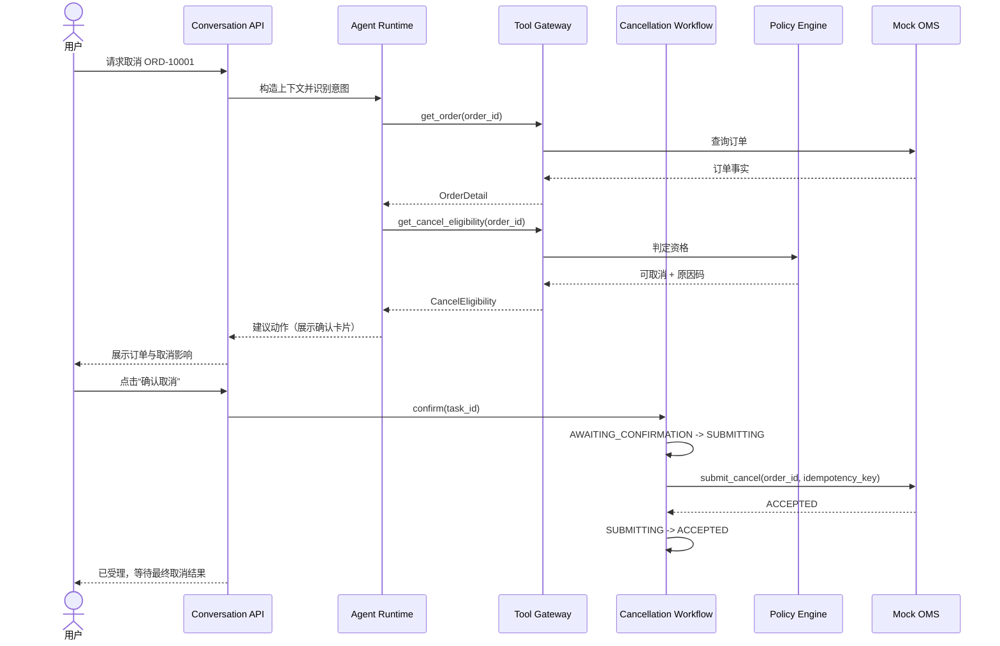
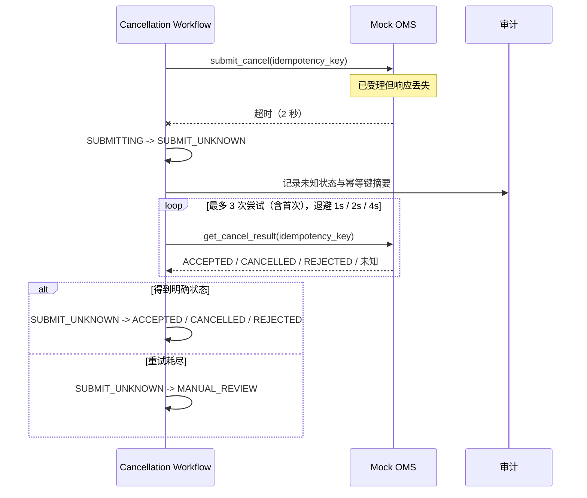

# M1 技术设计：订单查询与未发货订单取消

- 状态：已批准
- 批准：2026-11-15（用户确认，含测试账号登录页与 AC-20）；2026-11-16 澄清确认（状态迁移表与 T-11 结果文案）
- 变更说明：
  - 2026-11-14 增加取消主流程与超时恢复的时序图，并补 4.1 契约约定。
  - 2026-11-15 第 3 节新增 OMS 侧 `OmsCancelState` 四态；`submit_cancel` 成功响应收敛为 `ACCEPTED`，拒绝与未知改由错误封套表达。
  - 2026-11-15 第 2 节明确订单归属由本地归属索引判定、不触达 OMS；接入真实 OMS 时需补一个订单归属的只读投影。
  - 2026-11-15 第 12 节登录页按 Q-2 去掉角色展示；账号切换明确为“退出后重新登录”。
  - 2026-11-15 第 12 节“输出中”由流式改为非流式等待，流式输出拆为后续任务（T-18 决策）。
  - 2026-11-15 第 12 节刷新行为改为不恢复历史（T-10 决策），读取接口留待后续任务。
  - 2026-11-15 第 12 节“不取消”改为发送一次状态收尾请求，失败时等超时转 `ABANDONED`（T-14 决策）。
  - 2026-11-15 第 3 节明确资格 Tool 可读取 OMS 订单事实，但判定只由 Policy Engine 产出（T-08 决策）。
  - 2026-11-16 第 2 节状态迁移由箭头图改为迁移表（澄清，不改行为）。
  - 2026-11-16 第 7 节补结果文案唯一来源、校验规则、调用位置与冲突优先级；第 12 节终态卡片补原因与下一步（T-11 澄清）。
- 关联需求：`requirements.md`

## 1. 设计原则

- Agent Runtime 不直接访问 OMS 或数据库业务表。
- 取消资格由 Policy Engine 决定。
- 取消提交由 Cancellation Workflow 驱动。
- Tool Gateway 负责鉴权、Schema、超时、错误归一化和审计。
- Mock OMS 模拟真实系统的状态、延迟和故障。

## 2. 逻辑组件

### Conversation API

接收 Web Chat 消息，建立认证上下文，将消息持久化后交给 Agent Runtime。

### 身份与租户

- 开发期提供测试账号选择页；选择后由 `POST /session` 建立会话 Cookie，`DELETE /session` 退出。
- 测试账号固定为两个租户各两个用户，登录页只做选择，不要求密码；不实现注册、找回密码与第三方登录。
- 会话解析在中间件完成，请求体不得覆盖 `tenant_id`、`user_id`；未认证请求返回 401 并引导到登录页。
- 存在两个租户，每租户两个用户；身份由服务端会话解析，请求体不得携带或覆盖 `tenant_id`、`user_id`。
- 跨租户用例必须命中真实存在的第二租户数据，不接受仅靠参数非法来模拟。

### Agent Runtime

- 构建最小必要上下文。
- 识别查询、取消、澄清、确认和人工请求。
- 在允许的 Tool 列表中选择查询 Tool。
- 输出结构化动作建议，不直接执行写操作。

### Tool Gateway

- 根据租户和用户上下文执行授权；订单归属由本地归属索引判定，不调用 OMS（满足 AC-02“不调用 OMS”）。
- 本地归属索引在 Mock 阶段与 OMS 共享同一份夹具数据，只回答“该订单是否属于当前租户与用户”，不返回订单内容。
- 校验 Tool 输入 Schema。
- 注入可信的 `tenant_id`、`user_id`、`trace_id`。
- 应用超时、有限重试、结果归一化和审计。

### Policy Engine

输入订单和用户权限上下文，输出：

- 是否允许取消。
- 原因码和用户可理解说明。
- 是否需要额外确认或人工审批。

M1 不调用模型做资格判断。

资格判定以 Policy Engine 为唯一权威。Mock OMS 只提供订单事实（状态、归属、履约进度），不返回资格结论；`get_cancel_eligibility` 由 Policy Engine 实现，不代理 OMS。两者结论不一致的情况在设计上不存在，因为不存在第二个判定来源。

### 取消主流程时序



### 超时与恢复时序



### Cancellation Workflow

状态迁移以表为准；幂等与重试规则见第 4 节。

| from | event | guard | to | 副作用 |
|---|---|---|---|---|
| COLLECTING | 用户请求取消，资格通过 | 归属校验通过 | AWAITING_CONFIRMATION | 持久化任务 |
| COLLECTING | 用户请求取消，资格不通过 | — | ELIGIBILITY_REJECTED | 记录原因码 |
| AWAITING_CONFIRMATION | 用户确认 | 未过期 | SUBMITTING | 调 submit_cancel |
| AWAITING_CONFIRMATION | 用户放弃 | — | ABANDONED | 不写 OMS |
| AWAITING_CONFIRMATION | 确认超时 | — | ABANDONED | 不写 OMS |
| SUBMITTING | submit 返回 `ACCEPTED` | — | ACCEPTED | 持久化终态，可刷新 |
| SUBMITTING | submit 返回 `OMS_REJECTED` | — | REJECTED | 持久化终态 |
| SUBMITTING | submit 超时或非法响应 | — | SUBMIT_UNKNOWN | 记录错误码与幂等键摘要 |
| SUBMIT_UNKNOWN | 查询得到明确状态 | — | ACCEPTED / CANCELLED / REJECTED | 持久化终态 |
| SUBMIT_UNKNOWN | 重试耗尽 | — | MANUAL_REVIEW | 转人工 |
| ACCEPTED | 查询返回 `CANCELLED` | — | CANCELLED | 推进终态 |
| 任意终态 | 重复确认或放弃 | — | 不变 | 幂等返回 |

`COLLECTING` 与 `AWAITING_CONFIRMATION` 是已持久化的任务状态，不是会话内存状态；任务在用户表达取消意图时即创建，`ABANDONED` 为其未提交的终点，不产生任何 OMS 写调用。

### Mock OMS

提供可控 API：

- 查询单个订单。
- 列出最近订单。
- 幂等提交取消。
- 按幂等键查询取消结果。
- 故障注入：延迟、超时、重复响应、格式错误和后端已成功但响应丢失。

预置夹具：每个租户 4 单，分别覆盖 `PAID_UNFULFILLED`、`FULFILLING`、`SHIPPED`、`CANCELLED`；每租户另有 1 单属于同租户其他用户，用于越权用例。

## 3. Tool 契约草案

### `list_recent_orders`

```json
{
  "limit": 5
}
```

服务端自动注入身份字段。返回订单摘要列表，不向模型暴露无权访问订单。

### `get_order`

```json
{
  "order_id": "ORD-10001"
}
```

错误分类：

- `NOT_FOUND_OR_UNAUTHORIZED`
- `DEPENDENCY_UNAVAILABLE`
- `INVALID_RESPONSE`

### `get_cancel_eligibility`

```json
{
  "order_id": "ORD-10001"
}
```

返回：

```json
{
  "eligible": true,
  "reason_code": "UNFULFILLED",
  "requires_confirmation": true
}
```

该 Tool 由 Policy Engine 判定；网关为取得订单事实会读取 Mock OMS 的只读接口，但**判定结论只由 Policy Engine 产出**。`reason_code` 是唯一权威原因码，Agent 只能转述，不能改写或补写。

### `submit_cancel`

```json
{
  "order_id": "ORD-10001",
  "idempotency_key": "opaque-key"
}
```

该 Tool 不由 Agent 自由调用，只允许 Cancellation Workflow 在确认状态后调用。

成功响应只返回 `ACCEPTED`；拒绝、超时与非法响应通过统一错误封套表达（`OMS_REJECTED`、`DEPENDENCY_TIMEOUT`、`INVALID_RESPONSE`），避免同一业务结果同时存在“状态”和“错误码”两种表达。

### `get_cancel_result`

```json
{
  "idempotency_key": "opaque-key"
}
```

返回 OMS 侧的 `OmsCancelState` 四态：`ACCEPTED`、`CANCELLED`、`REJECTED`、`UNKNOWN`。Workflow 的内部状态（如 `COLLECTING`、`AWAITING_CONFIRMATION`）不得出现在该响应中。

## 4. Workflow 与幂等

- 用户表达取消意图时创建持久化取消任务，初始状态为 `COLLECTING`。
- 只有用户明确确认后才允许进入 `SUBMITTING`；确认前一律不得调用 OMS 写接口。
- 幂等键在任务创建时生成，后续重试复用。
- `COLLECTING` 或 `AWAITING_CONFIRMATION` 超过确认超时未推进，转入 `ABANDONED`；默认 30 分钟，可由环境变量覆盖，测试中设为 1 秒。
- OMS 单次调用超时 2 秒。
- 失败最多 3 次尝试（含首次），间隔 1s / 2s / 4s，耗尽后进入 `MANUAL_REVIEW`。
- 数据库对 `(tenant_id, idempotency_key)` 建唯一约束。
- 如果写调用超时，Workflow 进入 `SUBMIT_UNKNOWN`。
- 恢复器按幂等键调用 `get_cancel_result`。
- 仅当 OMS 返回明确状态时推进 Workflow。
- 重试耗尽后进入 `MANUAL_REVIEW`。

## 4.1 契约约定

跨模块传递的领域数据遵循以下约定，定义见 `packages/contracts/schemas/domain.json`：

- 金额一律为整数分（`amount_cents`），禁止浮点；币种单独字段，三位大写字母。
- 时间一律为带 `Z` 的 ISO 8601 UTC 字符串；偏移量形式与时间戳数字一律拒绝，展示层再转本地时区。
- 订单摘要的 `cancelable` 必须由订单状态推导，不得由调用方随意传入。
- 错误码的七类分类与“可重试 / 对用户可见”属性见 `services/api/domain/errors.py`；越权统一为 `NOT_FOUND_OR_UNAUTHORIZED`。
- 字段级正反例由契约测试保证，见 `tests/unit/domain/test_contract_schemas.py`。

## 5. 数据模型草案

### `conversations`

- `id`
- `tenant_id`
- `user_id`
- `channel`
- `created_at`
- `updated_at`

### `messages`

- `id`
- `conversation_id`
- `role`
- `content`
- `trace_id`
- `created_at`

### `cancellation_requests`

- `id`
- `tenant_id`
- `user_id`
- `conversation_id`
- `trace_id`
- `order_id`
- `idempotency_key`
- `state`
- `last_error_code`
- `oms_request_id`
- `version`
- `created_at`
- `updated_at`

### `tool_executions`

- `id`
- `trace_id`
- `tool_name`
- `tenant_id`
- `user_id`
- `order_id`
- `idempotency_key_digest`
- `input_digest`
- `result_status`
- `latency_ms`
- `error_code`
- `response_redacted`
- `created_at`

### `audit_events`

- `id`
- `trace_id`
- `tenant_id`
- `actor_type`
- `actor_id`
- `event_type`
- `entity_type`
- `entity_id`
- `order_id`
- `idempotency_key_digest`
- `result_status`
- `metadata_redacted`
- `created_at`

## 6. Runtime 决策输出

Agent 输出建议使用结构化动作，例如：

```json
{
  "type": "tool_call",
  "tool": "get_order",
  "arguments": {
    "order_id": "ORD-10001"
  }
}
```

或：

```json
{
  "type": "clarify",
  "question": "请确认是哪一个订单？",
  "candidates": ["ORD-10001", "ORD-10002"]
}
```

写操作不直接作为 Agent 的普通 Tool 输出，而由 Workflow 在确认后触发。

## 7. 回复结果校验

### 7.1 唯一文案来源

结果文案只有一处：`services/api/domain/cancellation.py` 的 `render_result(state, reason_code)`，返回：

- `state_text`：状态标签，取自 `requirements.md` 第 9 节“内部状态与用户可见表达”。
- `reason_text`：仅 `ELIGIBILITY_REJECTED` 非空，由 `reason_code` 映射；其他状态为 `None`。
- `next_step`：每个状态一条固定下一步句。
- `reply`：`state_text` + 原因（仅资格拒绝）+ `next_step` 的完整句，模板见 `requirements.md` 第 9 节“结果回复模板”。

`services/agent_runtime/validator.py` 的 `validate_reply(state, reason_code, draft)` 只做校验与替换，不维护第二份文案。

`ELIGIBILITY_REJECTED` 的 `state_text` 沿用需求第 9 节表达表的“不可取消，并说明原因”，原因由 `reason_text` 单独展示；标签精简不在 T-11 范围。五类结果名是验收分类，不是逐字文案；`SUBMITTING` 保持“正在提交取消申请”。

### 7.2 校验规则

- 期望值：`render_result(...).reply`。
- 等价：`draft.strip()` 与期望值逐字相等才算通过；否则替换为期望值，返回 `replaced=True`、`mismatch="REPLY_MISMATCH"`。
- 不做语义等价、同义词或模型重写；M1 的最终文案必须逐字一致，避免同一状态出现第二种表达。因此 `ACCEPTED` 不可能被表述为 `CANCELLED`，`SUBMIT_UNKNOWN` 不可能被表述为成功或失败。
- 空草稿、超长草稿、重复草稿一律按不一致替换；不设长度上限，长度不影响判定，只有逐字相等才通过；校验无副作用，可重复调用。
- 校验是纯函数：无 I/O、无超时；超时场景指上游提交/查询超时，由任务状态承接。
- 失败关闭：未知状态、`ELIGIBILITY_REJECTED` 缺 `reason_code`、文案表缺项时抛 `ValueError`，不输出兜底文案；接口层按 500 处理，不发送未经校验的回复。这类错误只可能是程序错误，全部 10 个状态的文案由单测在 CI 阻断缺项。

### 7.3 调用位置

| 出口 | 使用方式 | 证据 |
|---|---|---|
| `/message` 的取消结果回复 | `ConversationService` 在持久化 assistant 消息前调用 `validate_reply`，持久化替换后的回复 | `/message` 响应与消息表 |
| `POST/GET /cancellation-requests` | `_public` 用 `render_result` 输出 `state_text`、`reason_text`、`next_step`；不接收草稿 | 接口字段 |
| `ConfirmCard` 终态 | 展示 `state_text`、`reason_text`、`next_step`；不得展示裸 `reason_code` | 组件测试 |

查询、澄清、转人工与通用错误回复不在本任务范围，沿用现有出口；若后续改由模型生成，必须先接入同一个 `validate_reply`。

### 7.4 冲突与优先级

1. 持久化任务状态是唯一权威；错误码只在 Workflow 内映射为状态，不能覆盖状态。
2. 终态优先：`ACCEPTED` 查询失败仍为 `ACCEPTED`；`CANCELLED`、`REJECTED` 不被后续错误降级。
3. 重复确认或重复请求按当前持久化状态渲染，文案不变。
4. 状态表与草稿冲突时以状态表为准；`state_text` 是标签，不单独作为最终回复发送。
5. “不得声称已退款”只约束结果回复；确认卡片中的规则说明不算结果回复。
6. 未知文案按出口归属：任务状态为 `SUBMIT_UNKNOWN` 时用“已提交，正在核实受理结果”；只有传输/依赖异常且拿不到任务状态时，界面才用“状态未知，正在核实”。两者不得互换。

### 7.5 观测

- validator 返回 `replaced` 与 `mismatch`；`response.validate` span 记录 `state`、`reason_code`、`replaced`、`mismatch`，不记录草稿全文。
- 具体落盘由 T-12 承接；本任务至少保证返回值可观测。

## 8. 可观测性

M1 目标：AC-17 可还原、AC-18 不泄露。M1 不引入 OpenTelemetry；Span 名称保留为未来映射，不作为本期依赖。

### 8.1 存储与查询

- `trace_id` 由服务端生成（UUIDv4 字符串），不信任客户端；每轮 `/message` 生成一个，取消任务持久化发起时的 trace。
- 新增表：`tool_executions`、`audit_events`；`cancellation_requests` 增加 `trace_id`；新增迁移 `0006_trace_audit`。
- `tool_executions` 记录工具名、订单、结果分类、错误码、耗时、输入摘要、幂等键摘要与 `response_redacted`；`result_status` 为 `started`/`ok`/`failed`/`rejected`；不保存完整入参/响应。
- `response_redacted` 只允许业务结果字段：`order_id`、`order_status`、`cancelable`、`eligible`、`reason_code`、`state`；禁止金额、商品明细、支付信息。
- `audit_events` 记录意图、确认、状态转换、最终回复、转人工；含 `order_id`、`idempotency_key_digest`、`result_status` 与 `metadata_redacted`（只含允许清单字段）。
- `load_trace(session, trace_id, tenant_id)` 合并 `messages`、`tool_executions`、`audit_events`、取消任务，按时间排序；未知 trace 返回空 `TraceView`；必须按 `tenant_id` 过滤。
- 直接 `POST /cancellation-requests` 在响应中返回 `trace_id`；`/message` 已返回 `trace_id`；UI 不展示。
- 开发期查询 CLI：`scripts/show-trace.py --trace-id ... --tenant-id ...`；输出 JSON，空 trace 输出空 JSON 并以退出码 1 结束；不暴露 HTTP 或界面。
- CLI 输出是本地调试输出，可能含 `messages` 正文；它不是日志 sink，不受 AC-18 的日志字段约束，但不得接入生产日志。

### 8.2 trace_id 传播

- `/message` 生成 t，`ConversationService` 将 t 传给意图、Tool、消息持久化与审计。
- `CancellationWorkflow.request` 持久化 t；`confirm`、`abandon`、`get` 读取 `task.trace_id`，不得重新生成 uuid。
- 直接 `POST /cancellation-requests` 生成 t 并持久化；后续 confirm/abandon 复用。
- 启动恢复按每个任务的 `trace_id` 使用；`recover_pending` 不再接收全局 `startup-*` trace，主入口不得生成 `startup-{uuid4()}`。
- Tool 调用一律使用当前 trace；不得在 Gateway 内新建 trace。
- 重复确认/放弃复用任务 trace；不新增第二条主链路。

### 8.3 审计写入与失败

| event_type | 触发 | 关键字段（允许清单） |
|---|---|---|
| `INTENT_CLASSIFIED` | 每轮意图识别 | intent、order_id、needs_clarification |
| `WORKFLOW_TRANSITION` | 状态变更 | task_id、from_state、to_state、reason_code、result_status |
| `CONFIRMATION` | confirm/abandon | task_id、action、result_status |
| `REPLY` | 最终回复 | state、replaced、mismatch |
| `HANDOFF` | 转人工 | conversation_id、pending_step |

- Tool 调用写 `tool_executions`。Gateway 在 worker 线程通过请求级 `TraceSink` 记录：调用 handler 前 `start` 写 `started` 行并等待落库；handler 成功/失败后 `finish` 更新结果。`start` 失败则不调用 handler 并返回 500；`finish` 失败返回 500，`started` 行保留，由幂等键与恢复查询判定实际结果，不宣称成功。
- `TraceSink` 由 API 在请求上下文创建；worker 线程通过 `ContextVar` 取得，使用 `run_coroutine_threadsafe` 把写库协程提交回请求事件循环并等待确认；禁止在 Gateway 线程直接建 async session。
- 工作流状态变更、确认、消息回复、转人工的审计行与对应业务写入在同一个数据库事务内：`CancellationRepository.create/save`、消息 `add_message`、`create_handoff` 内写 `audit_events`；审计失败则回滚并返回 500。
- 审计失败抛独立 `TraceSinkError`，它不是 `GatewayError`。`ToolGateway._record` 的审计调用必须先 `except TraceSinkError: raise`，其余审计异常一律转 `TraceSinkError`，不得包成 `GatewayError`；`ToolGateway.invoke` 的兜底 `except Exception` 也要先重抛 `TraceSinkError`。
- `services/api/main.py` 注册 `TraceSinkError` 全局异常处理器，返回 500 `INTERNAL_ERROR`；`/message`、取消接口与 Workflow 的业务错误处理不得捕获它并转成 200 回复或 `SUBMIT_UNKNOWN`。
- 审计失败时 API 统一返回 500 `INTERNAL_ERROR` 通用错误，不暴露审计细节；写操作由幂等键保护，重试不重复提交；不得静默丢弃审计。
- 启动恢复遇到 `TraceSinkError` 只记录 warning，保留任务为可恢复状态，不标记成功、不吞掉错误。
- 重复确认每次请求写一条 `CONFIRMATION` 事件，`result_status=idempotent`；不新增 `WORKFLOW_TRANSITION`/`TOOL_CALL`，状态与回复不变。

### 8.4 日志与脱敏

- 日志为 JSON 行到 stdout；每条至少含 `trace_id`、`event`、`tenant_id`、`user_id`。禁止输出消息/回复正文、完整 prompt、完整 Tool/OMS 报文。
- 统一 `redact_event` 允许清单：`trace_id`、`event`、`tenant_id`、`user_id`、`account_id`、`order_id`、`task_id`、`conversation_id`、`tool`、`event_type`、`state`、`from_state`、`to_state`、`action`、`result_status`、`error_code`、`reason_code`、`latency_ms`、`idempotency_key_digest`、`replaced`、`mismatch`、`needs_clarification`。
- 禁止：令牌、密码、`sid`/Cookie、完整卡号、完整手机号、完整地址、完整消息/回复、原始幂等键。
- 幂等键摘要固定为 `sha256(key).hexdigest()[:16]`；日志/审计只存摘要。`cancellation_requests.idempotency_key` 是业务幂等所需原键，保留在业务表，但不得进入日志/审计。
- `messages` 正文为会话恢复所需，保留原文；AC-18 只约束日志/审计，但正文不得进入日志/审计。

### 8.5 OpenTelemetry 引入条件

M1 不引入 SDK。满足任一条件时另立 ADR + 依赖审批：

- 出现第二个可部署单元（worker/队列/独立适配服务），需要跨进程传播；
- 接入真实 OMS/支付/物流，需要 span 级耗时与重试分布；
- 需要采样、APM 后端、告警或 trace 瀑布图；
- M2 多渠道/多 Agent，单 trace_id 无法表达父子关系。

未来映射：现有 UUID 可转为 32 位 hex；增加 `span_id`/`parent_span_id`，Span 名称沿用第 8.7 节。

### 8.6 测试

- AC-17：查询、直接创建、取消、超时恢复、启动恢复、越权拒绝、重复确认各一条 `load_trace` 断言；确认链路首条消息与任务 `trace_id` 一致；直接创建响应含 `trace_id`；启动恢复前后任务 trace 不变；未知 trace 返回空且 CLI 退出码 1。
- AC-18：注入手机号/令牌/卡号/地址/原始幂等键，断言日志与审计不含；原始幂等键只允许出现在 `cancellation_requests`；审计元数据只含允许清单；审计写失败返回 500 且不静默成功。
- Tool 写前记录：`start` 失败不调用 handler；`finish` 失败保留 `started` 且不宣称成功；恢复查询可判定实际结果。
- 审计异常不被业务 catch 吞掉：Tool/Workflow/`/message` 的审计失败均返回 500，不返回 200；同事务路径回滚，写前路径保留 `started`。
- 查询隔离：`load_trace` 带租户过滤，跨租户返回空。

### 8.7 未来 Span 映射

```text
conversation.turn
  intent.classify
  context.build
  model.generate
  tool.call
    authorization.check
    oms.request
  workflow.transition
  response.validate
```

## 9. 测试策略

- Contract tests：Tool 输入输出与 Mock OMS。
- Unit tests：资格规则、状态机、幂等键和结果校验。
- Integration tests：API + Workflow + Mock OMS。
- Adversarial tests：越权订单号、Prompt 注入、非法 Tool 参数。
- Fault injection：超时、后端已成功但响应丢失、格式异常。
- Scenario evals：脚本化模型下的多轮编排，以及 pytest AC 聚合报告。

### 9.1 场景评测

- `evals/run.py` 是报告生成器：读取 pytest `--junitxml` 输出，按测试名 `_AC_XX` 聚合为 AC 报告；不重新执行测试。
- 多轮场景是普通 pytest 集成用例（`tests/integration/test_eval_scenarios.py`），使用 `FakeModelClient` 脚本化重放；测试名带 AC 后缀，自动进入聚合报告。
- 报告 `evals/reports/latest.json` 每次覆盖，同时写 `evals/reports/<timestamp>.json`；字段含 AC、通过/失败、测试数、失败测试名、多轮场景耗时。
- 缺失任一 AC、JUnit 解析失败、空测试集、断言失败都退出 1；失败报告照样写。
- JUnit 固定写到 `evals/reports/latest-junit.xml`。`scripts/eval.sh` 用 `set +e` 先跑 `test-db.sh`（带 JUnit），无论 pytest 是否失败都调用 `evals/run.py`；`verify.sh` 复用同一 JUnit，不重复跑测试。
- 真实模型不在 T-13 范围；后续另立任务记录模型/提示词版本与趋势。

## 10. 待确认技术决策

技术选型只在本节维护；业务与范围待确认项见 `docs/CURRENT.md`，两处不重复列同一件事。

已由 `docs/adr/0004-engineering-baseline.md` 关闭：目录结构、依赖管理与版本策略、前端框架、编码与检查规范。
Web Chat 的界面结构、状态与确认交互由 `design.md` 第 12 节 规定。

已关闭：

- 模型接入：定义可替换的模型调用接口，M1 只实现一个供应商；具体供应商与结构化输出方案在 T-09 任务设计卡中选定。
- Trace：M1 只要求 `trace_id` 贯穿结构化日志，导出后端在 T-12 决定。

本节已无未决事项。

## 12. 界面设计

### 1. 范围

M1 只有一个入口：单页面 Web Chat，一次只处理一个会话。

非目标：

- 会话列表、历史会话切换和跨会话搜索。
- 多标签页并发操作同一订单。
- 深色模式、移动端原生适配、富文本与附件、消息编辑与撤回。

### 2. 页面结构

页面分未登录与已登录两种形态：未登录只显示登录页，已登录显示左侧窄栏与主区。

### 登录页

- 结构：产品名 + 一句说明 + 测试账号列表（每项显示姓名与租户展示名；M1 无角色模型，不显示角色）+ 选中后的“进入”按钮。
- 说明文案必须标注“开发期测试账号”，避免被误认为真实登录。
- 登录成功后进入会话页；已登录时可从顶部栏退出。切换账号通过“退出后重新登录”完成，M1 不单独提供切换入口。

| 区域 | 内容 |
|---|---|
| 左侧窄栏 | 宽度 72px，只放品牌标识、帮助入口与“转人工”按钮；不放会话列表 |
| 会话标题栏 | 会话标题、在线状态、会话编号与开始时间 |
| 消息区 | 可滚动；“时间为左、内容为右”的两列排版，用户消息靠右 |
| 输入区 | 双层结构：上行输入文本，下行提示与发送按钮；底色 `#FAFAFA`、1px `#E4E4E7` 描边，聚焦时转白并显示强调色描边与 3px 外发光 |

- 确认卡片出现在对应消息内，包含商品行（名称、订单号与状态、金额）、取消规则与退款说明、影响提示，以及“确认取消”和“不取消”两个按钮。
- 空态提供两个带图标的建议入口，只作引导，不代替输入。
- 图标使用内联 SVG，线宽 1.6，尺寸 16 或 20；不引入图标库与远程字体。
- 对话区底色为白色，用户消息使用 `#F4F4F5` 气泡；气泡与底色必须保持可分辨的对比，不能把两者都设成接近的浅灰。
- 输入区右下角显示字数上限（如 0/500），等待响应或已转人工时整块置灰并停止可编辑。
- M1 没有会话列表、工单列表与坐席后台，这些属于路线图 M4。

### 3. 界面状态与呈现

界面状态由后端返回的任务状态驱动，前端不得自行推断。

| 界面状态 | 触发条件 | 呈现 |
|---|---|---|
| 空白态 | 无消息 | 引导语与一条示例问句 |
| 等待响应 | 消息已发送 | 输入区禁用，显示进行中指示 |
| 输出中 | 非流式等待 | 显示加载态；流式输出列为后续任务 |
| 等待确认 | 任务进入 `AWAITING_CONFIRMATION` | 展开确认卡片，两个按钮可用 |
| 提交中 | 任务进入 `SUBMITTING` | 提示条“正在提交取消申请”，确认按钮禁用 |
| 已提交、核实中 | 任务进入 `SUBMIT_UNKNOWN` | 提示条“已提交，正在核实受理结果”，确认按钮禁用 |
| 已受理 | 任务进入 `ACCEPTED` | 提示条“已受理，等待最终取消结果” |
| 终态 | `CANCELLED`、`REJECTED`、`ELIGIBILITY_REJECTED`、`ABANDONED` 或 `MANUAL_REVIEW` | 结果条，附原因（仅不可取消）、下一步说明与人工入口 |

对外文案必须取自 `requirements.md` 第 9 节的“内部状态与用户可见表达”表，完整结果句取自同节“结果回复模板”；界面不得自造措辞。

终态卡片按固定位置展示：`state_text` 原样作为状态 pill；`reason_text` 非空时以“原因：”前缀单独一行；`next_step` 原样作为提示行。前端不得拼接、改写或显示裸 `reason_code`。

任务处于 `COLLECTING` 时，界面停留在“等待响应”或“输出中”，只显示进行中指示，不展示确认控件；`COLLECTING` 不是独立界面状态，但必须被界面显式承接。

### 4. 确认交互规则

- 用户必须通过点击“确认取消”完成确认；输入框里的“好的”“可以”不作为确认依据，由 Agent 引导到按钮。
- 点击“确认取消”后按钮立即禁用并进入“已提交、核实中”，避免重复点击产生第二个请求。
- **幂等键由后端生成并随任务持久化，前端不得生成、拼接或缓存幂等键。** 网络重试、刷新后重发都由后端按键去重。
- 点击“不取消”：界面提示“已取消本次操作”，向任务接口发送一次状态收尾请求（不写 OMS）；若该请求失败，任务在确认超时后由后端转为 `ABANDONED`。该提示只描述本次操作，不是订单状态，也不进入结果回复校验。
- 页面刷新后不恢复历史消息与任务状态（M1 决策：不新增读取接口）；后续补读取接口后再按后端数据恢复，不得凭本地缓存猜测。

### 5. 错误与未知

- 网络错误：提示“请求未完成”，提供重试；重试沿用同一任务，不新建任务。
- 后端返回未知或依赖异常：界面显示“状态未知，正在核实”，禁止显示成功或失败。这是传输/依赖异常时的界面提示，不是取消任务状态；任务状态文案仍以第 9 节模板为准。
- 任何情况下界面不得在未取得后端明确结果时宣称“已取消”。

### 6. 人工接管

- 顶部栏“转人工”始终可用，包括对话进行中与状态未知时。
- 点击后界面显示“已转人工”，并停止自动回复，避免人工与自动回复同时讲话。
- 转接上下文由后端组装，见 `requirements.md` FR-10；前端不负责拼装。

### 7. 可访问性底线

- 所有操作可用键盘完成，按钮有可见焦点。
- 状态变化用文字表达，不能只靠颜色区分。
- 输入框与按钮有可读标签，供屏幕阅读器识别。

### 8. 与验收用例的对应

| 页面行为 | 对应验收 |
|---|---|
| 确认卡片展示订单与影响，停在等待确认 | AC-04 |
| 确认按钮只产生一次请求 | AC-05、AC-09 |
| 不确认不产生请求 | AC-06 |
| 已发货订单只解释原因，不出现确认按钮 | AC-07 |
| 未知状态措辞不得成成功或失败 | AC-10、AC-11 |
| 五种结果表达正确 | AC-16 |
| 终态展示原因与下一步，不显示裸原因码 | AC-16 |
| 转人工携带上下文 | AC-13 |

### 9. 结构参考稿

`assets/ui-mockup.html` 用静态页面画出六个界面状态：空白态、等待响应、等待确认、已提交核实中、已受理、终态。

- 用途：确认区域划分、状态顺序与文案是否合理。
- 不是：视觉设计规范，也不规定颜色、字号、间距。
- 冲突处理：参考稿与本文第 2 至 4 节冲突时，以本文为准。

直接用浏览器打开即可查看：`open docs/specs/001-order-cancel/assets/ui-mockup.html`。

### 10. 视觉与组件规范

视觉令牌与组件契约统一维护在 `docs/design-system/ui-spec.md`，组件状态参考 `docs/design-system/ui-components.html`。本节不再重复取值，避免两处漂移。

页面级约束：

- 目标是现代、克制，看起来像正常的客服工作台，而不是演示用的 AI 产品。
- 状态用正文加前置小圆点表达，不使用色条、色块或彩色文字压浅底。
- 对话区底色为白，用户消息使用 `--surface-2` 气泡；两者必须保持可分辨的对比。
- 输入区右下角显示字数上限；等待响应或已转人工时整块置灰并停止可编辑。
- 强调色只出现在可交互元素与当前状态上，占屏面积不超过 5%。


## 13. 会话安全基线

目标：把 AC-21 的三条约束固定在代码与测试里，而不是靠部署说明。

### 13.1 Cookie 属性

| 属性 | 规则 | 依据 |
|---|---|---|
| `HttpOnly` | 始终为真 | 前端脚本读不到 `sid` |
| `SameSite` | 始终为 `Lax` | 阻断跨站携带，同时保留顶层导航 |
| `Secure` | `ENVIRONMENT` 不是 `development`/`test` 时为真；可用 `COOKIE_SECURE` 显式覆盖 | 本机 HTTP 开发不受影响，共享环境强制加密 |
| `Max-Age` | 等于会话 TTL（8 小时） | 与服务端过期一致 |

配置来源唯一：`services/api/settings.py` 的 `secure_cookie` 属性。路由不得自行判断环境。

### 13.2 跨站写请求

- 适用范围：`POST`、`PUT`、`PATCH`、`DELETE`。
- 请求带 `Origin` 时，其主机必须等于请求的 `Host`，或命中 `ALLOWED_ORIGINS`（逗号分隔）。
- 开发与测试环境默认允许 `http://localhost:3000`、`http://127.0.0.1:3000`：Next 开发服务器把 `/api` 代理到后端，`Origin` 是前端地址而 `Host` 是后端地址。
- 经反向代理部署时，代理会改写 `Host`，必须把前端公网地址写入 `ALLOWED_ORIGINS`，否则写请求会被拒绝（失败关闭）。
- 不匹配时返回 403，且不进入路由处理，不产生业务副作用。
- 请求不带 `Origin` 时放行：命令行与内部调用没有该头；浏览器对跨站写请求一定会带。
- `GET`/`HEAD`/`OPTIONS` 不受影响。

实现位置：`services/api/csrf.py` 的中间件，在身份解析之后执行。

### 13.3 密钥与调试端点

- 密钥只从环境变量读取，仓库与 CI 都跑 `scripts/check-secrets.py`。
- `/_admin` 与测试账号接口只在 `development`/`test` 挂载，这一条保持不变；独立鉴权登记为遗留项（见 `docs/process/standards.md` STD-SEC-05）。

### 13.4 测试与证据

| 场景 | 观测点 |
|---|---|
| 开发环境登录 | Cookie 不含 `Secure`，含 `HttpOnly`、`SameSite=Lax` |
| 覆盖为安全模式 | Cookie 含 `Secure` |
| 生产默认 | `Settings().secure_cookie` 为真 |
| 同源写请求 | 通过 |
| 跨源写请求 | 403，且没有副作用 |
| 本地前端代理来源 | 通过（开发/测试默认白名单） |
| 不透明来源 `Origin: null` | 403 |
| 空 `COOKIE_SECURE=` | 按未设置处理，不阻止启动 |
| 无 `Origin` 的写请求 | 通过（命令行） |
| 跨源读请求 | 通过 |
