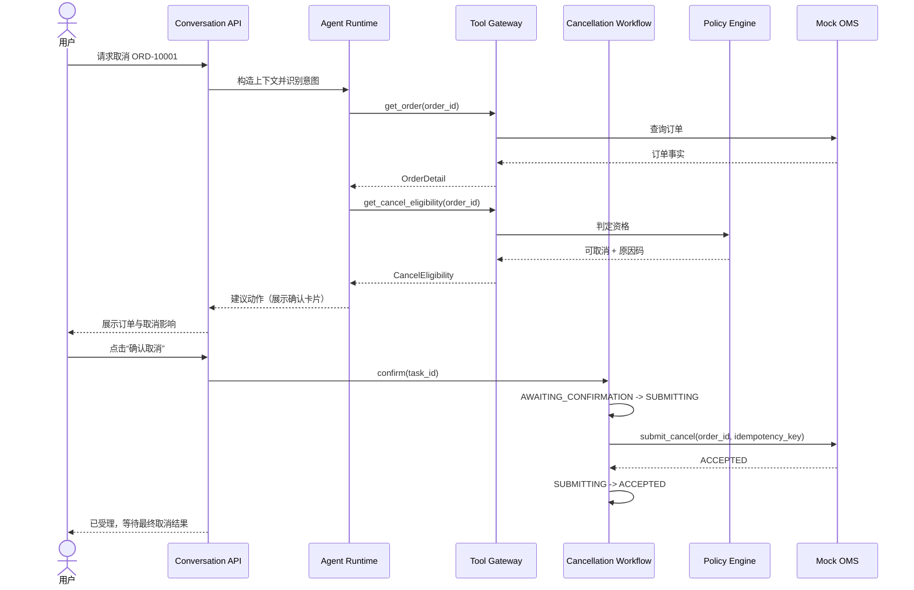
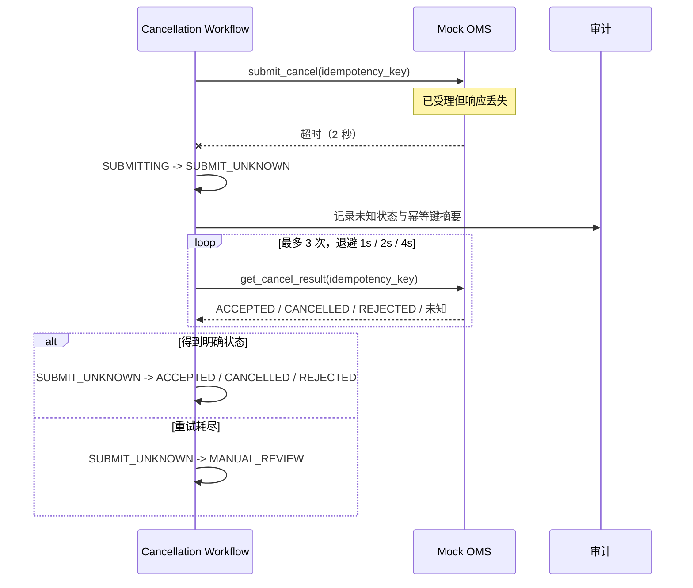

# M1 技术设计：订单查询与未发货订单取消

- 状态：等待评审
- 变更说明：2026-11-14 增加取消主流程与超时恢复的时序图，并补 4.1 契约约定。
- 关联需求：`requirements.md`

## 1. 设计原则

- Agent Runtime 不直接访问 OMS 或数据库业务表。
- 取消资格由 Policy Engine 决定。
- 取消提交由 Cancellation Workflow 驱动。
- Tool Gateway 负责鉴权、Schema、超时、错误归一化和审计。
- Mock OMS 模拟真实系统的状态、延迟和故障。

## 2. 逻辑组件

### Conversation API

接收 Web Chat 消息，建立认证上下文，将消息持久化后交给 Agent Runtime。

### 身份与租户

- 开发期使用固定测试账号与会话 Cookie，M1 不实现注册与登录。
- 存在两个租户，每租户两个用户；身份由服务端会话解析，请求体不得携带或覆盖 `tenant_id`、`user_id`。
- 跨租户用例必须命中真实存在的第二租户数据，不接受仅靠参数非法来模拟。

### Agent Runtime

- 构建最小必要上下文。
- 识别查询、取消、澄清、确认和人工请求。
- 在允许的 Tool 列表中选择查询 Tool。
- 输出结构化动作建议，不直接执行写操作。

### Tool Gateway

- 根据租户和用户上下文执行授权。
- 校验 Tool 输入 Schema。
- 注入可信的 `tenant_id`、`user_id`、`trace_id`。
- 应用超时、有限重试、结果归一化和审计。

### Policy Engine

输入订单和用户权限上下文，输出：

- 是否允许取消。
- 原因码和用户可理解说明。
- 是否需要额外确认或人工审批。

M1 不调用模型做资格判断。

资格判定以 Policy Engine 为唯一权威。Mock OMS 只提供订单事实（状态、归属、履约进度），不返回资格结论；`get_cancel_eligibility` 由 Policy Engine 实现，不代理 OMS。两者结论不一致的情况在设计上不存在，因为不存在第二个判定来源。

### 取消主流程时序



### 超时与恢复时序



### Cancellation Workflow

管理：

```text
COLLECTING
  -> AWAITING_CONFIRMATION
  -> SUBMITTING
  -> ACCEPTED
  -> CANCELLED
```

异常分支：

```text
ELIGIBILITY_REJECTED
REJECTED
SUBMIT_UNKNOWN -> query result -> ACCEPTED/CANCELLED/REJECTED
SUBMIT_UNKNOWN -> retries exhausted -> MANUAL_REVIEW
COLLECTING / AWAITING_CONFIRMATION -> 超时或用户放弃 -> ABANDONED
```

`COLLECTING` 与 `AWAITING_CONFIRMATION` 是已持久化的任务状态，不是会话内存状态；任务在用户表达取消意图时即创建，`ABANDONED` 为其未提交的终点，不产生任何 OMS 写调用。

### Mock OMS

提供可控 API：

- 查询单个订单。
- 列出最近订单。
- 幂等提交取消。
- 按幂等键查询取消结果。
- 故障注入：延迟、超时、重复响应、格式错误和后端已成功但响应丢失。

预置夹具：每个租户 4 单，分别覆盖 `PAID_UNFULFILLED`、`FULFILLING`、`SHIPPED`、`CANCELLED`；每租户另有 1 单属于同租户其他用户，用于越权用例。

## 3. Tool 契约草案

### `list_recent_orders`

```json
{
  "limit": 5
}
```

服务端自动注入身份字段。返回订单摘要列表，不向模型暴露无权访问订单。

### `get_order`

```json
{
  "order_id": "ORD-10001"
}
```

错误分类：

- `NOT_FOUND_OR_UNAUTHORIZED`
- `DEPENDENCY_UNAVAILABLE`
- `INVALID_RESPONSE`

### `get_cancel_eligibility`

```json
{
  "order_id": "ORD-10001"
}
```

返回：

```json
{
  "eligible": true,
  "reason_code": "UNFULFILLED",
  "requires_confirmation": true
}
```

该 Tool 由 Policy Engine 提供，不查询 Mock OMS。`reason_code` 是唯一权威原因码，Agent 只能转述，不能改写或补写。

### `submit_cancel`

```json
{
  "order_id": "ORD-10001",
  "idempotency_key": "opaque-key"
}
```

该 Tool 不由 Agent 自由调用，只允许 Cancellation Workflow 在确认状态后调用。

### `get_cancel_result`

```json
{
  "idempotency_key": "opaque-key"
}
```

返回受理、取消、拒绝或未知状态。

## 4. Workflow 与幂等

- 用户表达取消意图时创建持久化取消任务，初始状态为 `COLLECTING`。
- 只有用户明确确认后才允许进入 `SUBMITTING`；确认前一律不得调用 OMS 写接口。
- 幂等键在任务创建时生成，后续重试复用。
- `COLLECTING` 或 `AWAITING_CONFIRMATION` 超过确认超时未推进，转入 `ABANDONED`；默认 30 分钟，可由环境变量覆盖，测试中设为 1 秒。
- OMS 单次调用超时 2 秒。
- 失败重试最多 3 次，间隔 1s / 2s / 4s，耗尽后进入 `MANUAL_REVIEW`。
- 数据库对 `(tenant_id, idempotency_key)` 建唯一约束。
- 如果写调用超时，Workflow 进入 `SUBMIT_UNKNOWN`。
- 恢复器按幂等键调用 `get_cancel_result`。
- 仅当 OMS 返回明确状态时推进 Workflow。
- 重试耗尽后进入 `MANUAL_REVIEW`。

## 4.1 契约约定

跨模块传递的领域数据遵循以下约定，定义见 `packages/contracts/schemas/domain.json`：

- 金额一律为整数分（`amount_cents`），禁止浮点；币种单独字段，三位大写字母。
- 时间一律为带 `Z` 的 ISO 8601 UTC 字符串；偏移量形式与时间戳数字一律拒绝，展示层再转本地时区。
- 订单摘要的 `cancelable` 必须由订单状态推导，不得由调用方随意传入。
- 错误码的七类分类与“可重试 / 对用户可见”属性见 `services/api/domain/errors.py`；越权统一为 `NOT_FOUND_OR_UNAUTHORIZED`。
- 字段级正反例由契约测试保证，见 `tests/unit/domain/test_contract_schemas.py`。

## 5. 数据模型草案

### `conversations`

- `id`
- `tenant_id`
- `user_id`
- `channel`
- `created_at`
- `updated_at`

### `messages`

- `id`
- `conversation_id`
- `role`
- `content`
- `trace_id`
- `created_at`

### `cancellation_requests`

- `id`
- `tenant_id`
- `user_id`
- `conversation_id`
- `order_id`
- `idempotency_key`
- `state`
- `last_error_code`
- `oms_request_id`
- `version`
- `created_at`
- `updated_at`

### `tool_executions`

- `id`
- `trace_id`
- `tool_name`
- `tenant_id`
- `user_id`
- `input_digest`
- `result_status`
- `latency_ms`
- `error_code`
- `created_at`

### `audit_events`

- `id`
- `trace_id`
- `tenant_id`
- `actor_type`
- `actor_id`
- `event_type`
- `entity_type`
- `entity_id`
- `metadata_redacted`
- `created_at`

## 6. Runtime 决策输出

Agent 输出建议使用结构化动作，例如：

```json
{
  "type": "tool_call",
  "tool": "get_order",
  "arguments": {
    "order_id": "ORD-10001"
  }
}
```

或：

```json
{
  "type": "clarify",
  "question": "请确认是哪一个订单？",
  "candidates": ["ORD-10001", "ORD-10002"]
}
```

写操作不直接作为 Agent 的普通 Tool 输出，而由 Workflow 在确认后触发。

## 7. 回复结果校验

最终回复生成前，Result Validator 将模型输出与权威业务结果对照：

- 不得把 `ACCEPTED` 表述为 `CANCELLED`。
- 不得把 `SUBMIT_UNKNOWN` 表述为失败或成功。
- `SUBMITTING` 只能表述为“正在提交”；`SUBMIT_UNKNOWN` 只能表述为“已提交，正在核实受理结果”。二者均不得表述为已受理或已取消。
- 不得声称已退款。
- 必须包含下一步或人工路径。

## 8. 可观测性

建议 Span：

```text
conversation.turn
  intent.classify
  context.build
  model.generate
  tool.call
    authorization.check
    oms.request
  workflow.transition
  response.validate
```

日志与审计只记录必要的 ID、状态和错误码。禁止记录：令牌、密码、完整卡号、完整手机号、完整地址；允许记录：订单号、用户 ID、状态、错误码。

## 9. 测试策略

- Contract tests：Tool 输入输出与 Mock OMS。
- Unit tests：资格规则、状态机、幂等键和结果校验。
- Integration tests：API + Workflow + Mock OMS。
- Adversarial tests：越权订单号、Prompt 注入、非法 Tool 参数。
- Fault injection：超时、后端已成功但响应丢失、格式异常。
- Scenario evals：模型完成多轮澄清和 Tool 选择。

## 10. 待确认技术决策

技术选型只在本节维护；业务与范围待确认项见 `docs/CURRENT.md`，两处不重复列同一件事。

已由 `docs/adr/0004-engineering-baseline.md` 关闭：目录结构、依赖管理与版本策略、前端框架、编码与检查规范。
Web Chat 的界面结构、状态与确认交互由 `ui.md` 规定。

已关闭：

- 模型接入：定义可替换的模型调用接口，M1 只实现一个供应商；具体供应商与结构化输出方案在 T-09 任务设计卡中选定。
- Trace：M1 只要求 `trace_id` 贯穿结构化日志，导出后端在 T-12 决定。

本节已无未决事项。

